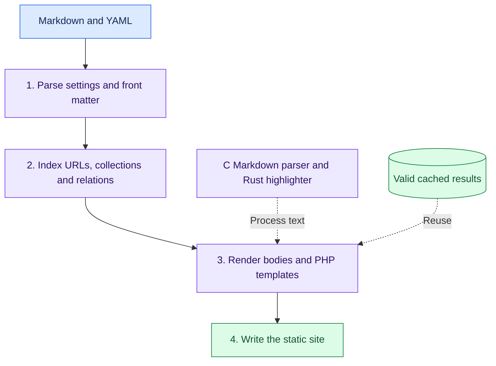
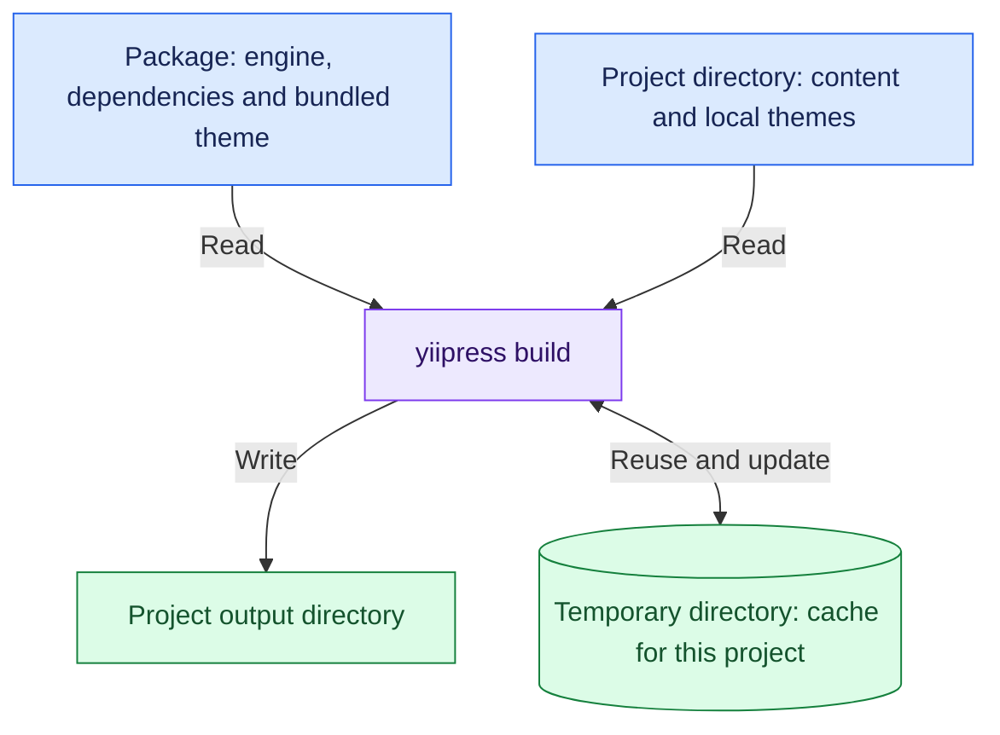

A site build produces pages and shared files such as listings and feeds. Later builds can reuse results whose inputs
have not changed. A change can affect more than its own page, so YiiPress also tracks output dependencies.

## What a build does

The site build has four main steps:

1. **Parse.** Read YAML configuration and entry front matter, the settings at the start of each Markdown file.
   The parser also reads each body to find inline tags. Each entry stores the body's position in the source file instead
   of keeping the full body in memory. Rendering can read it again when needed.
2. **Index.** Resolve page URLs, filter drafts and future entries, sort collections, and connect authors and taxonomies.
3. **Render.** Read entry bodies, run content processors, convert Markdown to HTML, and render PHP templates.
4. **Write.** Save pages, listings, feeds, the sitemap, search data, and assets.

Incremental builds reuse earlier results when the relevant inputs have not changed.
YiiPress uses source hashes, rendering settings, and output dependencies to decide what to rebuild.
Native extensions make text processing faster; the cache avoids repeating work.

## Rebuild the outputs that depend on a change

An entry body change can require its page and a feed that includes it. A listing also depends on the entries selected
for that page and their order. A sitemap depends on URLs and dates, so it can stay unchanged after a body-only edit.
Configuration, navigation, authors, and asset fingerprints can affect several outputs.

YiiPress records these dependencies and commits the build records after a successful build. Missing or invalid cache
records trigger normal rebuild work. The cache is disposable; the content files remain the source of truth.

## Keep package files separate from project files

The embedded archive contains the engine. The user's website lives outside it.
YiiPress uses package paths to read its own files. It uses the project directory, where the command runs, to find site
content, local themes, and output paths.

A package may be installed in a directory where the user cannot write files.
For PHAR and binary installations, YiiPress therefore stores its runtime cache and incremental build records in the
operating system's temporary directory. The cache location depends on the project path, so separate projects have
separate caches. `yiipress clean` removes the project's build cache and the configured output directory.

For the cache records and invalidation rules, see [Engine](../engine.md).
