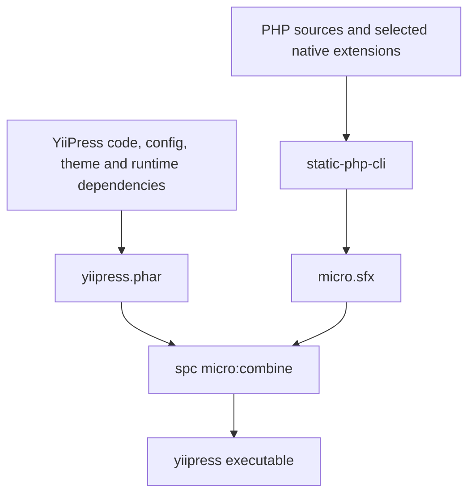

YiiPress is written in PHP, but you can download it as a single executable and use it without installing PHP or Composer.
How does that fit together? The interesting parts are inside the binary: a PHP runtime, a PHAR archive, native extensions,
and a build pipeline that leaves ordinary static files behind.

This post follows the internals covered in my talk, “PHP in a binary, using YiiPress as an example.”
The aim is to show how the pieces work together and the constraints that shaped them.

## A PHP runtime and an application in one file

The application still runs on the Zend Engine. Packaging it as an executable does not turn its PHP classes into native
machine code. Instead, YiiPress combines a PHP runtime with the application it will execute.

[static-php-cli](https://static-php.dev/) builds the runtime and its selected extensions.
Its [micro SAPI](https://micro.static-php.dev/en/index.html) provides an executable stub, `micro.sfx`,
which can be combined with PHP code or a PHAR archive. A PHAR is PHP's application archive format: it holds the program
and dependencies in one file, with a startup script called a stub.

The core of YiiPress's Linux packaging path looks like this:

When the executable starts, the bundled runtime runs the PHAR stub. The stub maps the archive and loads the `yii` entry
script inside it, which starts the console application. The user runs `yiipress build` or `yiipress serve`;
PHP and the application's dependencies are already in the package.

The same micro-plus-PHAR approach underlies the macOS and Windows builds, with separate platform build scripts.
An executable is built for its target operating system and architecture; one Linux file is not a universal binary.

## Keep the package focused

Bundling a complete development environment would make distribution unnecessarily large. YiiPress narrows both sides
of the package.

On the application side, the PHAR builder includes `config/`, `src/`, `themes/`, runtime Composer dependencies, and the
`yii` entry script. Development dependencies stay out. The archive filter removes non-runtime files such as dependency
tests, examples, documentation, and development-tool configuration. Comment stripping preserves metadata that runtime
code reads through reflection, and the PHAR entries are gzip-compressed.

On the runtime side, the build selects the extensions the engine needs. Markdown conversion, highlighting, YAML, and
XML output are examples; there is no need to bundle every extension available to PHP. The Linux build uses musl for
static linking and applies UPX executable compression. Platform packaging details differ, so the PHAR, executable,
and compressed download should not be treated as the same size measurement.

YiiPress also keeps its application layer focused. It uses plain PHP templates instead of bringing in a view/widget
stack. Its preview server uses ReactPHP streams, so the package does not need an FPM or Apache SAPI just to offer
`yiipress serve`.

## PHP coordinates; native code handles the hot paths

Yii3 provides dependency injection, console integration, and the preview application's routing and middleware.
The content model, index, processors, templates, and writers are composed around those services.

Two expensive text-processing jobs run in native extensions:

- `ext-mdparser`, from `iliaal/mdparser`, converts Markdown through MD4C, a C parser.
- `ext-highlighter`, from `yiipress/highlighter`, performs syntax highlighting through syntect, written in Rust.

The packaging build links these extensions into the runtime. Users do not have to locate and install separate Markdown
or highlighting shared libraries. PHP remains responsible for connecting the parts and deciding what work is needed.

During a build, YiiPress first parses YAML configuration and entry front matter. Entry parsing also reads each body to
extract inline tags. Entries retain source offsets instead of keeping all Markdown bodies in memory, so rendering can
load them again when needed. The site index resolves URLs, filters drafts and future entries, sorts
collections, and connects authors and taxonomies. Rendering loads the bodies it needs, runs content processors,
converts Markdown, and renders PHP templates. Writers save the resulting pages and supporting output, including
listings, feeds, sitemap, search data, and copied assets.

Incremental builds use source hashes, rendering context, and output dependencies to reuse work when the inputs have not
changed. This complements the native extensions: faster processing helps, but avoiding unnecessary processing helps too.

## Workers need their own PHAR handles

Parallel rendering exposed a constraint that is easy to miss in a source checkout. A forked process inherits open file
descriptors. If parent and child read from the same PHAR descriptor, their shared read position can interfere with
concurrent autoloading and lead to archive corruption errors such as a CRC32 mismatch.

YiiPress's rendering worker pool starts independent processes with `proc_open()` instead. Each process opens its own
package, reconstructs the required pipeline, receives a rendering job, and writes independent output files.
This avoids sharing the PHAR's read position and also gives the pool a process model that works on Windows.
The trade-off is process startup and setup cost, so small batches stay sequential where the engine's thresholds apply.

## The package and the project have different roots

The embedded archive contains the engine, not the user's website. Packaged code reads its own files through package
paths, while site content, local themes, and output paths are resolved from the project directory where the command runs.
A read-only installation must not become the place where a build tries to write its cache.

For PHAR and binary installations, YiiPress puts runtime cache and incremental manifests under the operating system's
temporary directory, keyed by the project path. Separate projects get separate cache locations.
`yiipress clean` removes the relevant build cache as well as the configured output directory.

## What gets deployed

The binary is a tool for building and previewing the site. `yiipress serve` offers live reload over generated output;
it does not make a PHP application server a requirement for the published website.

Run `yiipress build` and publish the contents of `output/` to a static host. The pages, feeds, styles, scripts, and assets
are the production site; content and template changes require another build. Set `base_url` to the site's public URL
so canonical links and feeds use that address.

For workflows that build inside a container, YiiPress also provides a distroless image containing the Linux executable.
It reuses the packaged runtime rather than installing PHP and Composer in the final image. Docker remains useful for
engine development, where debugging and build tools belong.

The result is a PHP application that can be distributed like a command-line tool while keeping PHP's libraries,
composition, and template model. The same approach can be useful for other PHP tools, provided their extensions,
filesystem assumptions, and process model fit the package.

For the source-level details, see [Engine](../engine.md) and [Binaries, PHAR, Docker](../binaries-phar-docker.md).
To build a site of your own, start with the [Quickstart](../quickstart.md).
