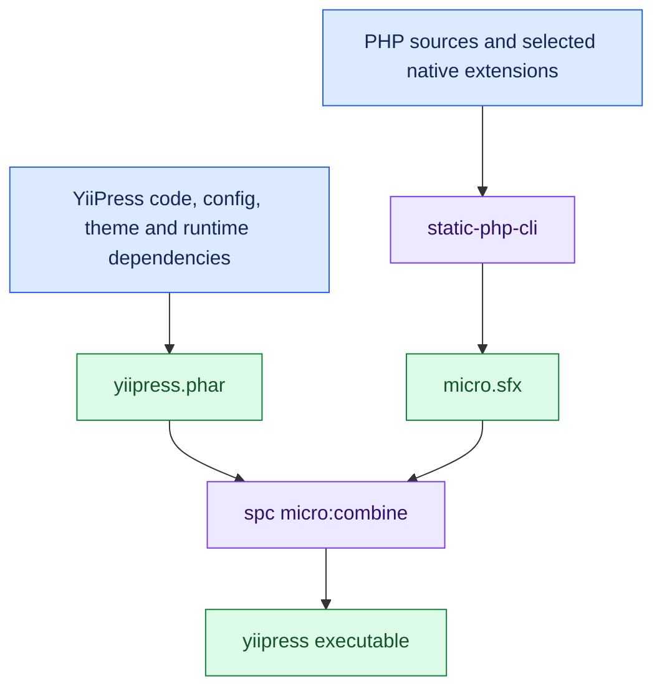

YiiPress is written in PHP, but you can use it without installing PHP or Composer.
You download one executable file. It contains PHP, the YiiPress code, and the extensions needed to build your site.
The build produces static files that you can publish to a web host.

## PHP and the application in one file

YiiPress still runs on the Zend Engine, the engine that executes PHP code.
The packaging process does not convert PHP classes into machine code. It puts a PHP runtime and the application in one
file. The runtime is the part that executes the PHP code.

[static-php-cli](https://static-php.dev/) builds PHP with the selected extensions.
Its [micro SAPI](https://micro.static-php.dev/en/index.html) runs PHP from a single executable.
It provides a file called `micro.sfx`, which can be combined with PHP code or a PHAR archive.
A PHAR is an archive that holds a PHP application and its dependencies. It also contains a startup script called a stub.

The Linux build combines these parts:

When you run the executable, PHP runs the PHAR stub. The stub makes the archive's files available and loads the `yii`
script inside it. That script starts the console application. You can then use commands such as `yiipress build` and
`yiipress serve`.

The macOS and Windows builds also combine micro and PHAR, but use separate build scripts.
Each executable runs on its target operating system and CPU architecture. A Linux executable cannot run on every platform.

## Run the packaged tool

YiiPress also provides a Linux distroless container image for building sites.
This is a small image containing the packaged executable, without a separate PHP or Composer installation.
Engine development uses a separate Docker environment with debugging and build tools.

This packaging approach lets users run a PHP application as a single command-line tool.
The application keeps its PHP libraries and templates. Other PHP tools can use the same approach if their extensions,
file access, and worker processes work inside such a package.

For more detail, see [Engine](../engine.md) and [Binaries, PHAR, Docker](../binaries-phar-docker.md).
To build your own site, start with the [Quickstart](../quickstart.md).
