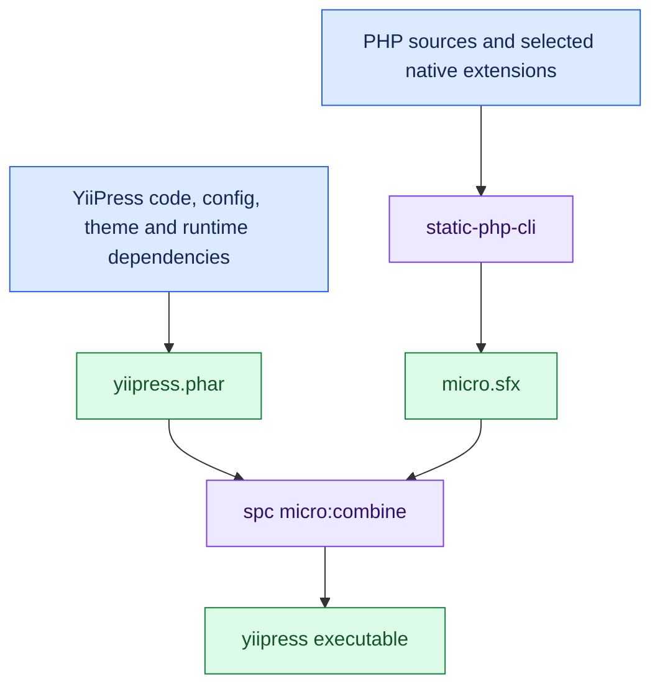
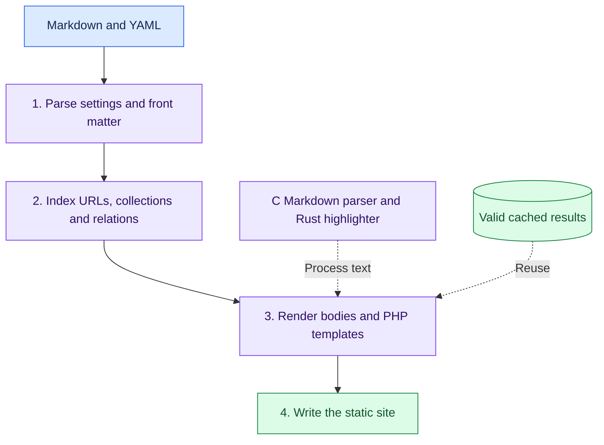
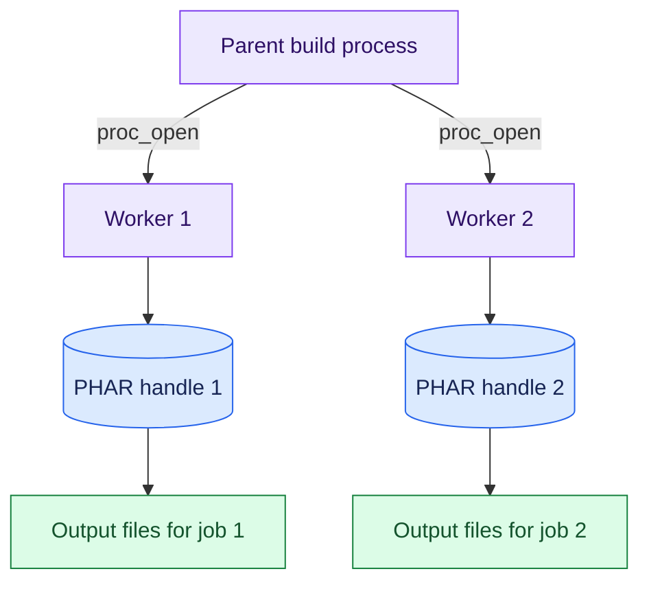
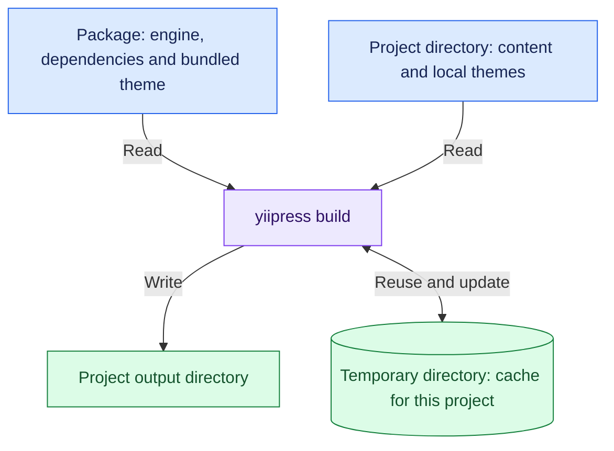
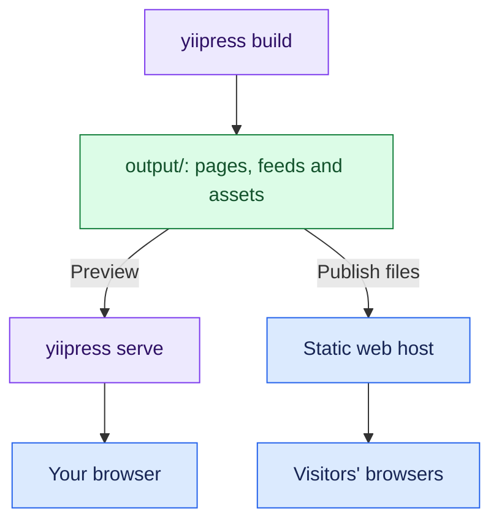

YiiPress is written in PHP, but you can use it without installing PHP or Composer.
You download one executable file. It contains PHP, the YiiPress code, and the extensions needed to build your site.
The build produces static files that you can publish to a web host.

## PHP and the application in one file

YiiPress still runs on the Zend Engine, the engine that executes PHP code.
The packaging process does not convert PHP classes into machine code. It puts a PHP runtime and the application in one
file. The runtime is the part that executes the PHP code.

[static-php-cli](https://static-php.dev/) builds PHP with the selected extensions.
Its [micro SAPI](https://micro.static-php.dev/en/index.html) runs PHP from a single executable.
It provides a file called `micro.sfx`, which can be combined with PHP code or a PHAR archive.
A PHAR is an archive that holds a PHP application and its dependencies. It also contains a startup script called a stub.

The Linux build combines these parts:

When you run the executable, PHP runs the PHAR stub. The stub makes the archive's files available and loads the `yii`
script inside it. That script starts the console application. You can then use commands such as `yiipress build` and
`yiipress serve`.

The macOS and Windows builds also combine micro and PHAR, but use separate build scripts.
Each executable runs on its target operating system and CPU architecture. A Linux executable cannot run on every platform.

## Keep the download small

YiiPress includes the files and extensions it needs to run. Development tools stay out of the package.

The PHAR contains `config/`, `src/`, `themes/`, Composer runtime dependencies, and the `yii` script.
The archive filter removes files such as dependency tests, examples, documentation, and development-tool settings.
The build also strips comments, but keeps metadata that running code reads through reflection, PHP's way to inspect
classes at runtime.
Files inside the PHAR use gzip compression.

The PHP build includes selected extensions for tasks such as Markdown conversion, code highlighting, YAML parsing, and
XML output. It does not include every PHP extension. On Linux, the build uses musl to link libraries into the executable
and UPX to compress it. Other platforms use different packaging steps.
The PHAR, the executable, and the compressed download are different files, so their sizes differ too.

The application also avoids parts it does not need. It uses plain PHP templates without a view or widget stack.
Its preview server uses ReactPHP streams. It does not need FPM or Apache to run `yiipress serve`.

## PHP connects the parts; native code processes the text

Yii3 supplies dependency injection, console integration, routing, and middleware for the preview application.
YiiPress uses these services to connect its content models, index, processors, templates, and file writers.

Two text-processing tasks use native extensions, which run compiled code:

- `ext-mdparser`, from `iliaal/mdparser`, converts Markdown to HTML with MD4C, a parser written in C.
- `ext-highlighter`, from `yiipress/highlighter`, highlights code with syntect, written in Rust.

The build includes these extensions in the PHP runtime. Users do not need to install separate Markdown or highlighting
libraries. PHP calls the extensions and controls the rest of the build.

The site build has four main steps:

1. **Parse.** Read YAML configuration and entry front matter, the settings at the start of each Markdown file.
   The parser also reads each body to find inline tags. Each entry stores the body's position in the source file instead
   of keeping the full body in memory. Rendering can read it again when needed.
2. **Index.** Resolve page URLs, filter drafts and future entries, sort collections, and connect authors and taxonomies.
3. **Render.** Read entry bodies, run content processors, convert Markdown to HTML, and render PHP templates.
4. **Write.** Save pages, listings, feeds, the sitemap, search data, and assets.

Incremental builds reuse earlier results when the relevant inputs have not changed.
YiiPress uses source hashes, rendering settings, and output dependencies to decide what to rebuild.
Native extensions make text processing faster; the cache avoids repeating work.

## Give each rendering worker its own archive

YiiPress can render pages in parallel. Each worker is a separate process that handles rendering jobs.

Starting workers with a process fork caused a problem with PHAR files. A child process inherits the parent's open file
handles. If both processes read the same PHAR handle, they share its read position. Concurrent class loading can then
read the wrong bytes and report an archive error, such as a CRC32 checksum mismatch.

The rendering pool uses `proc_open()` to start independent processes instead. Each worker opens its own package,
sets up the parts needed for rendering, receives a job, and writes separate output files.
The workers do not share a PHAR read position. This approach also works on Windows.

The two handles read the same packaged code, but each has its own read position.

Starting and setting up processes takes time. YiiPress therefore renders small batches sequentially when they fall below
its worker thresholds.

## Keep package files separate from project files

The embedded archive contains the engine. The user's website lives outside it.
YiiPress uses package paths to read its own files. It uses the project directory, where the command runs, to find site
content, local themes, and output paths.

A package may be installed in a directory where the user cannot write files.
For PHAR and binary installations, YiiPress therefore stores its runtime cache and incremental build records in the
operating system's temporary directory. The cache location depends on the project path, so separate projects have
separate caches. `yiipress clean` removes the project's build cache and the configured output directory.

## Publish the generated files

The executable builds the site and runs a local preview. `yiipress serve` serves the generated files and reloads the
browser when they change. The published website does not need a PHP application server.

Run `yiipress build`, then publish the contents of `output/` to a static host.
Those pages, feeds, styles, scripts, and assets are the website. Build again after changing content or templates.
Set `base_url` to the public site URL so canonical links and feeds use the correct address.

YiiPress also provides a Linux distroless container image for building sites.
This is a small image containing the packaged executable, without a separate PHP or Composer installation.
Engine development uses a separate Docker environment with debugging and build tools.

This packaging approach lets users run a PHP application as a single command-line tool.
The application keeps its PHP libraries and templates. Other PHP tools can use the same approach if their extensions,
file access, and worker processes work inside such a package.

For more detail, see [Engine](../engine.md) and [Binaries, PHAR, Docker](../binaries-phar-docker.md).
To build your own site, start with the [Quickstart](../quickstart.md).
