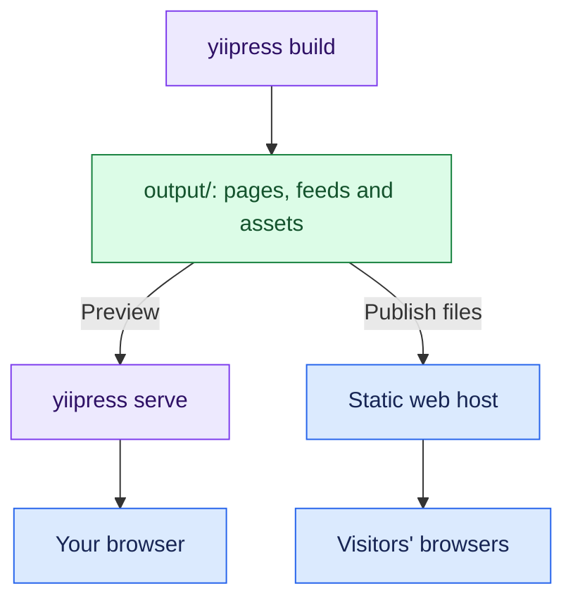

The preview server uses ReactPHP streams. It does not need FPM or Apache to run `yiipress serve`.

## Serve files from the output directory

Run the command from your project directory:

```shell
yiipress serve
```

By default, it reads `content/` and serves `output/` at `http://127.0.0.1:19777`. Use `--content-dir` and
`--output-dir` to choose other directories. The content directory must exist; the output directory must exist or be
creatable and writable.

A request for `/about/` reads `output/about/index.html`. A request for `/assets/logo.svg` reads the corresponding
output file. On the first request, the server starts a build if the output is empty or its build manifest is missing.

## Rebuild, then reload

The server injects a small script into served HTML. The script opens a Server-Sent Events connection to
`/_live-reload`, which lets the server send a message to the browser when a build finishes.

The watcher tracks content changes. It also watches a local `themes/` directory if it exists when the server starts.
Where inotify is available, it receives filesystem events; otherwise, the server checks file snapshots.
A change starts a normal build, using the same incremental cache as
`yiipress build`. A lock keeps preview workers from rebuilding the same output at the same time.

After a successful build, the browser reloads. If the build fails, the browser keeps the current page and shows the
build output in an error panel.

On supported platforms, the server can start independent PHP workers that share the listening socket. Windows uses
a single ReactPHP server process. These preview workers handle requests; they are separate from rendering workers
that run build jobs.

## Publish the generated files

The executable builds the site and runs a local preview. `yiipress serve` serves the generated files and reloads the
browser when they change. The published website does not need a PHP application server.

Run `yiipress build`, then publish the contents of `output/` to a static host.
Those pages, feeds, styles, scripts, and assets are the website. Build again after changing content or templates.
Set `base_url` to the public site URL so canonical links and feeds use the correct address.



For command options and preview behavior, see [Preview](../preview.md).
