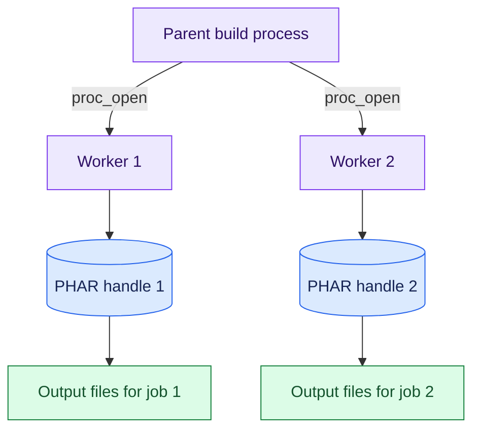

## Give each rendering worker its own archive

YiiPress can render pages in parallel. Each worker is a separate process that handles rendering jobs.

Starting workers with a process fork caused a problem with PHAR files. A child process inherits the parent's open file
handles. If both processes read the same PHAR handle, they share its read position. Concurrent class loading can then
read the wrong bytes and report an archive error, such as a CRC32 checksum mismatch.

The rendering pool uses `proc_open()` to start independent processes instead. Each worker opens its own package,
sets up the parts needed for rendering, receives a job, and writes separate output files.
The workers do not share a PHAR read position. This approach also works on Windows.

The two handles read the same packaged code, but each has its own read position.

Starting and setting up processes takes time. YiiPress therefore renders small batches sequentially when they fall below
its worker thresholds.

For worker jobs and build stages, see [Engine](../engine.md).
